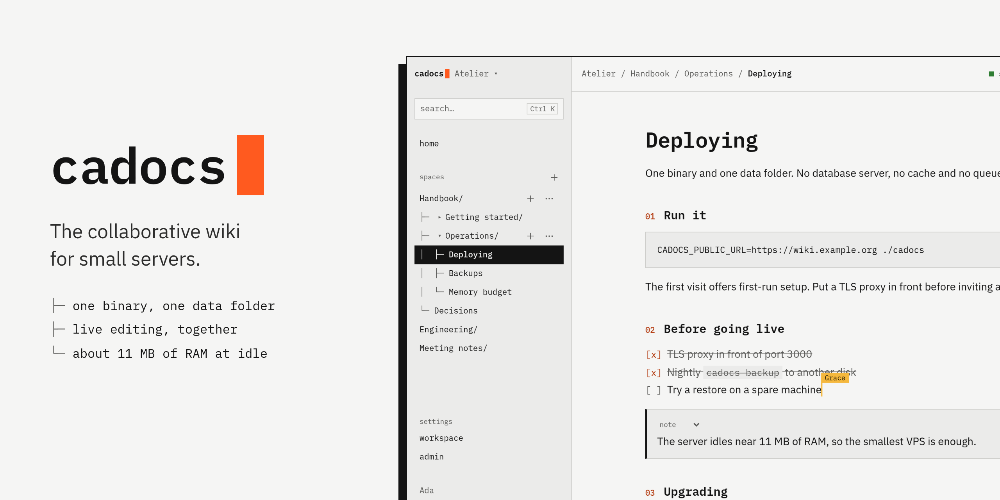

<picture>
  <source media="(prefers-color-scheme: dark)" srcset="docs/assets/promo-dark.png">
  
</picture>

# cadocs

A self-hosted collaborative wiki that fits on a small server. Pages are edited live by several people, organized in workspaces, spaces and a tree, with search, revisions, attachments and Markdown import and export.

It is one binary and one data folder, with no external service to run beside it. The server idles near 11 MB of RAM and stays under 100 MB with 30 people editing ([measures](docs/ARCHITECTURE.md#mvp-results)).

## Run it

The simplest way is the Docker image, `ghcr.io/mathieumarthy/cadocs`, for `x86_64` and `aarch64`. Save this as `compose.yaml`:

```yaml
services:
  cadocs:
    image: ghcr.io/mathieumarthy/cadocs:latest
    restart: unless-stopped
    environment:
      # The address people open. Behind a TLS proxy, its https:// address.
      CADOCS_PUBLIC_URL: http://127.0.0.1:3000
    ports:
      - "127.0.0.1:3000:3000"
    volumes:
      - cadocs-data:/data

volumes:
  cadocs-data:
```

Then start it and read the setup link it logs:

```bash
docker compose up -d
docker compose logs cadocs | grep setup
```

Open that link to create the first account. To open the wiki to others, put a TLS proxy in front and set `CADOCS_PUBLIC_URL` to its address, as [docs/OPERATIONS.md](docs/OPERATIONS.md#deployment) shows with Caddy. The same page covers configuration, backups and upgrades.

### From source

Build the front end, then the binary, which embeds it:

```bash
npm --prefix web ci && npm --prefix web run build
cargo build --release
CADOCS_PUBLIC_URL=http://127.0.0.1:3000 target/release/cadocs
```

The server logs a setup link at its first start, as above.

## Documentation

- [Architecture](docs/ARCHITECTURE.md) and the [decisions](docs/adr/) behind it
- [API](docs/API.md), [data model](docs/DATA_MODEL.md) and [permissions](docs/PERMISSIONS.md)
- [Roadmap](docs/ROADMAP.md)

## License

[AGPL-3.0](LICENSE)
